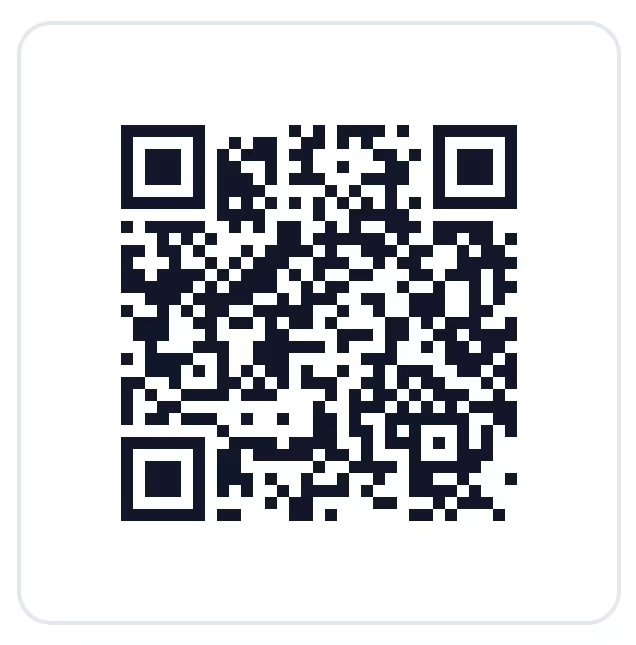

# AI 造出来的东西，商标、版权、专利到底算谁的？

📚 **[返回《知识产权实务系列》目录 →](/zhi-shi-chan-quan-shi-wu-xi-lie/)**

认识一个做独立品牌的小伙子，前阵子跟我描述了他一天的工作量：早上用 AI 出了个 Logo，顺手让模型想了十几个品牌名，挑了一个；中午写的产品文案和详情页，也是 AI 搭的骨架、他补的细节；下午最离谱——他那个带点小技术创新的产品，连核心方案的描述都是拿 AI 推出来的。

干完一圈，他突然懵了：这一整套东西，到底哪部分是"我的"？Logo 我能注册成商标吗？文案我能主张版权吗？那个技术方案，能去申请专利吗？

他问的不是孤例。现在但凡做点内容、做点产品，几乎都得碰 AI。可真到了要"确权"的时候，才发现这三块权利——商标、版权、专利——各自有一套完全不同的认定逻辑。今天不急着给结论，我们把这三摊事摊开聊一聊。

## 先说一个容易被忽略的前提

这三块权利，骨子里都在找一个东西：**"人"**。

著作权法保护的是"人"的智力成果，作者得是自然人或组织；专利法只认"对发明创造的实质性特点作出创造性贡献"的自然人当发明人；商标法虽然不直接问"作者是谁"，但它保护的是"人"在商业里用来识别来源的那个标志。

而 AI，法律上它不是"人"。这不是我说的，是目前各国大体一致的立场。所以你用 AI 造出的东西，能不能被这三块权利接住，关键从来不是"AI 能不能创作"，而是：**这里面，人的那部分，够不够、在哪里、能不能说清楚。**

有意思的是，三块权利找"人"的锚点，完全不一样。

## 著作权：找的是"作者"那个有独创性表达的人

版权这块，前面的文章聊过 AI 画图、AI 写稿，道理是一以贯之的——看人在里头投了多少智力。

法律要的那点"独创性"，藏在你的取舍里：为什么这么开头、为什么用这个例子、几十张图里为什么挑这一张、提示词改了几轮。北京互联网法院 2023 年那个 AI 文生图的案子，最后支持原告，理由不是"AI 画的图自动有版权"，而是看过程——他在提示词和参数上做了大量设计与筛选，那个个性化表达里有"人"。

所以版权的认定，本质是**按"人的参与深度"分档**：你定选题、给框架、喂材料、一段段改，那是助手模式，站得稳；你把题目一丢等它吐稿直接发，那是旁观者模式，真要主张权利就很悬。

## 专利权：找的是"发明人"那个对实质性特点有创造性贡献的人

专利这边，找"人"这件事更硬。

中国 2025 年修订的《专利审查指南》（2026 年 1 月 1 日起施行）说得明明白白：发明人必须是自然人，请求书里连人工智能的名字都不能填。国际上那个著名的 DABUS 案——有人想让 AI 系统自己当发明人去申请专利，在中国、美国、英国、欧盟全被拒了。美国的道理写得很透：发明人必须是对"构思"（conception）有显著贡献的自然人，AI 不是人，它再" instrumental"也不行。

但注意，拒绝"AI 当发明人"，不等于拒绝"AI 辅助的发明"。中美两边的态度其实很接近：AI 帮你干活可以，**只要有个真人对方案的实质性特点作出了创造性贡献，这个人就能当发明人**。美国专利局 2024 年的指引，用的就是"显著贡献"这套标准；中国国家知识产权局也区分了"AI 辅助发明"和"AI 生成发明"——前者人能署名，后者在现行法下没有合格的 AI 发明人。

所以专利认定的难点，卡在"创造性贡献"四个字上：你是用 AI 推了个方向、自己判断采纳并改进，还是只按了个按钮、出来什么算什么？

## 商标权：找的既不是"作者"也不是"发明人"，而是"使用"和"来源"

商标这块，逻辑跟前两块最不一样，也最容易被 AI 叙事带偏。

版权和专利，盯的是"创作/发明"那个动作里有没有人。商标不盯这个。商标保护的是"识别商品来源"的功能——说白了，你把这个标志用在生意里，让消费者一看到就知道东西是你家的，它才成其为商标。工具是人是 AI，对这件事本身没那么要紧。

但正因如此，AI 给商标带来的麻烦是另一面的：

一是**撞车更容易**。现在 AI 能一键批量生成几十个 Logo、几十个品牌名。生成的时候爽，可你没法保证它吐出来的名字没跟别人已注册的撞上。一旦高度近似、用在同类商品上，就是"混淆"，要担责任的还是你这个申请人——你没法跟审查员说"这是 AI 起的名"。

二是**显著性看结果不看工具**。一个 AI 生成的名字，能不能注册，和它"是不是 AI 写的"没关系，只取决于它能不能区分来源、会不会直接描述商品。这一点上，AI 生成物和人写物站在同一条起跑线上。

三是**恶意注册的风险反而被放大**。如果你的 AI 方案恰好贴着某个知名品牌的标志生成了一个高度相似的 Logo，又拿去注册，这很容易被认定为"恶意"——用 AI 批量碰瓷，比人工碰瓷成本低，审查口径只会更紧。

所以商标的认定，AI 基本没改变它的内核，却把它最容易踩的坑挖得更深了。

## 把三块放一起，有几个值得聊的开放问题

聊到这儿，其实比"算谁的"更有意思的，是几个还没定论、也值得每个用 AI 的人想一想的问题。

**第一，同一个人、同一个 AI，在三块权利里扮演的角色可以完全相反。** 你用 AI 出了 Logo 和文案，在版权和专利里，你是"有贡献的人"，能去主张权利；可同一个 AI 生成的标志要是撞了别人的商标，在商标这块你反而成了"可能侵权的人"。工具没变，你的法律位置却左右横跳。这事儿挺反直觉的。

**第二，AI 到底是在抬高门槛，还是降低门槛？** 版权这边，AI 让产出变得极便宜、极泛滥，那"独创性"反而显得更稀缺——以后法院看"人"的贡献，标准会不会悄悄抬高？专利这边更微妙：如果 AI 已经能帮人搞定大量"常规"问题，那判断"创造性"时参照的那个"本领域技术人员"，水平线会不会被 AI 抬上去？这些都不是今天能拍板的事，但趋势值得盯着。

**第三，AI 留下的"痕迹"，是保护伞也是靶子。** 前面说过，证明"人的贡献"最好留过程记录——提示词、版本、候选稿。AI 恰恰天然留痕，理论上比纯手工更好举证。可另一面，一旦你亮出"我用了 AI"，对方很可能反过来攻击你"贡献不足、不该享有权利"。留痕是双刃剑。

**第四，撞了别人的 IP，永远是用的人负责。** 这一点三块权利出奇一致：AI 不是民事主体，它不担责、不能当被告、也不能替你背锅。不管是生成图撞了画师、生成名撞了商标、还是方案撞了专利，落到实处的，都是那个把东西发出去、用起来的你。

## 那普通人现在能做的稳的事

我的看法是，别因为"AI 参与"就觉得啥都归你，也别因为"可能没权利"就什么都不敢碰。三块权利的认定逻辑不同，但有几条是共通的稳做法：

- 凡是重要的产出，把"人的那部分"留痕：选题、框架、提示词迭代、候选版本、采纳理由，攒在一起，别只留最终成品。
- 要拿去商用的图、名、文案，发布前该做的检索和 AI 标识（自 2025 年 9 月 1 日起，生成合成内容需按规定标识）一个都别省。
- 涉及商标注册和技术方案，先用检索把"撞车"风险排掉，再谈归属——很多问题，在"它是不是我的"之前，先得解决"它会不会是别人的"。

## 今天就能做的一件事

如果你最近用 AI 出过 Logo、写过稿、或者推过方案，现在花十分钟，挑出你最在意的那一项，把从想法到成品的过程记录归到一个文件夹，文件名标上日期和用途。这个动作本身不改变权利归属，但它把你从"我说不清"变成"我拿得出"——而在这三块认定里，"拿得出"往往就是分水岭。

你觉得，以后"人用 AI 造出来的东西"和"AI 替人造出来的东西"，法律该不该区别对待？如果区别，那条线你画在哪儿？评论区聊聊。

（资料来源：《中华人民共和国著作权法》关于作品与作者的规定；北京互联网法院涉 AI 生成图片著作权纠纷案（2023）；《专利审查指南》（2023）及 2025 年修改（2026 年 1 月 1 日施行）、国家知识产权局《人工智能相关发明专利申请指引（试行）》（2024）；国家知识产权局 DABUS 复审决定（第 1373038 号）；最高人民法院《关于依法审理涉人工智能纠纷案件的意见》（2026）；美国专利商标局《Inventorship Guidance for AI-Assisted Inventions》（2024）、Thaler v. Vidal（Fed. Cir. 2022）；《人工智能生成合成内容标识办法》（2025 年 9 月 1 日施行）。）

---

AI 造出的东西到底归谁、三块权利怎么认定，这套规则还在摆动态。如果你也在用 AI 做内容、起品牌、搞研发，拿不准它受不受保护、撞没撞别人的权，可以先试我们的免费自测工具「知识产权维权诊断师」，把你的使用方式和权利类型填进去，它会给你一份能直接打印的判断清单。

👉 在线版：https://legaldata.zhenzhidaole.com/ip-risk-diagnosis

微信扫码或复制链接打开即可。本工具为流程指引与普法性质，不构成正式法律意见，重大案件建议咨询执业律师。
