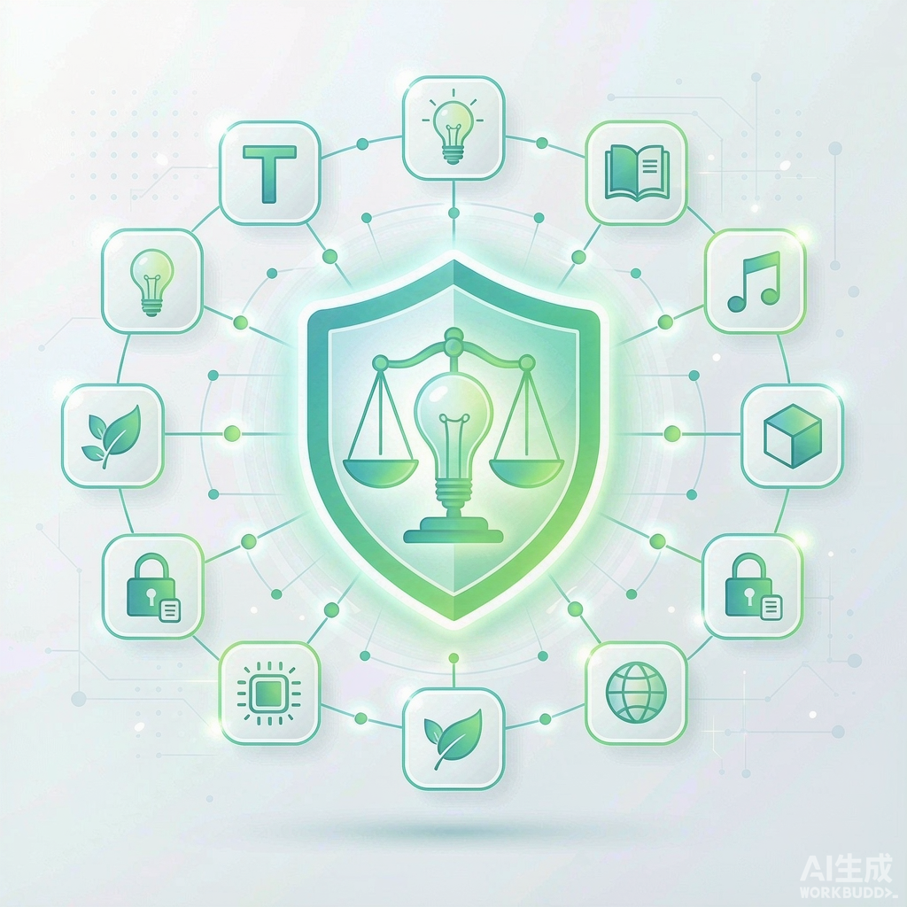
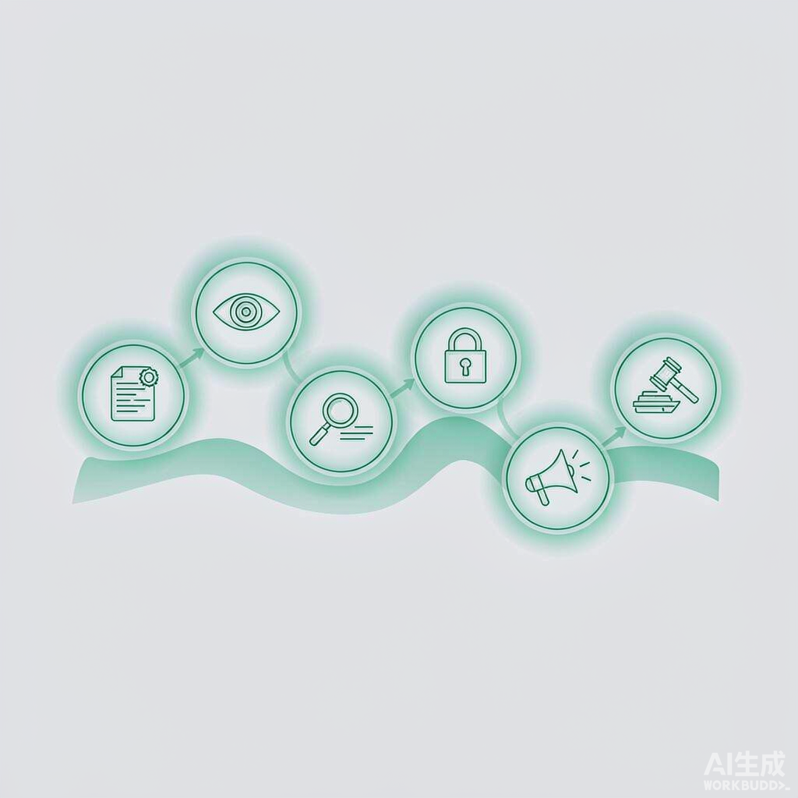
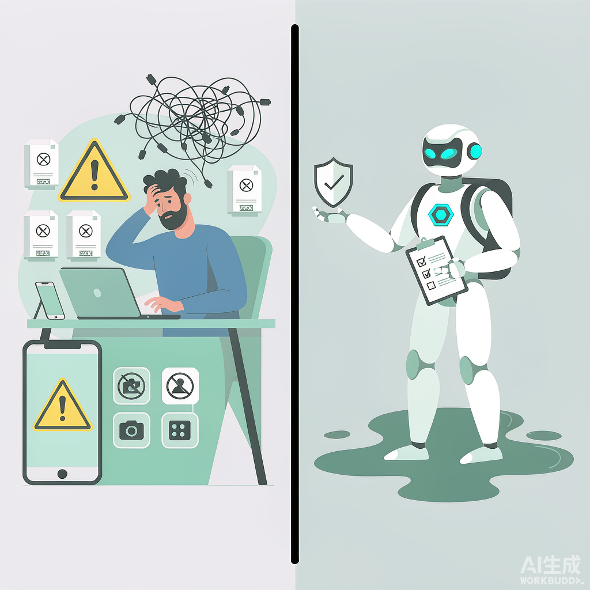
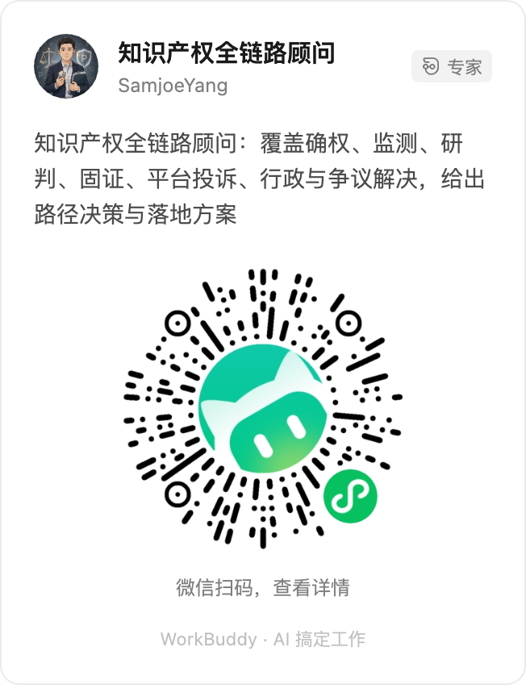

# 被抄袭、被抢注以后，第一步到底该走哪条路？

📚 **[返回《知识产权实务系列》目录 →](/zhi-shi-chan-quan-shi-wu-xi-lie/)**

有人跟你说"赶紧起诉"，有人劝你"先去平台投诉"，还有人让你"找工商局举报"。同样是被抄、被抢注，这三句话差的可不只是麻烦程度。

很多人一发现侵权就慌了：要么冲上去跟对方理论，要么直接找律师准备打官司。可你要是把这几条路拆开看，会发现绝大多数情况根本用不着走到起诉那一步。走错路，不只是多花钱，还可能把自己原本稳赢的局搞砸。比如你跑去起诉，却发现自己连权利基础都没站稳；或者你急着找对方对质，反而打草惊蛇让人把证据删了。

所以这篇文章不聊"侵权成立不成立"那种基础题，就聊一件更实在的事：**发现出事了，第一步到底该往哪条路走。**

## 动手前，先看清你手里拿的是哪张牌

维权的第一步，我觉得从来不是"我要告谁"，而是先看清自己手里拿的是哪张牌，牌稳不稳。

如果你的护身符是**商标**，得先看它注册了没有、注册在哪些类别。一个只在第 25 类（服装）注册的商标，管不了别人在第 9 类（电子产品）上用同名。这是很多人栽跟头的地方。如果是**专利**，得看是发明、实用新型还是外观设计，保护范围和有效期都不一样；专利还得是经过审查授权的，自己觉得"独特"不代表法律认。如果是**版权**，好处是创作完成即自动产生，但你得能证明"这东西确实是你先做的、你原创的"，而这一点恰恰是后面固证要解决的。

说句实话，我见过太多人，权利本身就有瑕疵，却一门心思想着"怎么把对方告倒"。牌没理顺就去打，输的往往不是对方，是自己。所以确权是整条链路的地基：地基松，上面盖什么都白搭。

## 三条路，成本和杀伤力天差地别

把常见的维权路径摊开，说到底就是三条，从轻到重：

**第一条，平台投诉。** 针对电商（淘宝、拼多多、京东）和内容平台（抖音、小红书、公众号）。你提交权属证明和侵权比对，平台审核通过后直接下架、断链、封店。它最大的优点是快、便宜，花的主要是时间，不花律师费，而且不用你证明"赔偿多少"，目标就是让侵权内容消失。缺点是它只解决"下架"，拿不到赔偿，对方换个店还能再来。

**第二条，行政投诉。** 找市场监管局（管商标、不正当竞争）、版权局或知识产权局。行政机关有调查权和处罚权，能责令停止侵权、罚款，甚至没收销毁侵权商品。它比平台投诉更有强制力，又不像法院那么漫长昂贵。适合那种"反复侵权、平台删了又冒出来"的顽固情况。

**第三条，法院起诉。** 这是最重的一张牌，也是唯一能拿到**赔偿**的路。前面两篇里我们聊过打官司要花多少钱、合理维权开支还能计入赔偿，但起诉的门槛、周期和风险也最高，动辄大半年，证据要求最严。它适合侵权规模大、对方有赔付能力、你志在拿到真金白银的情况。

怎么选？一句话：**你的目标决定路径**。只想让内容消失，平台投诉就够了；想要处罚和威慑，走行政；想要回钱，才考虑起诉。别一上来就盘算"我能不能告赢"，先想清楚你要的是"下架"还是"赔钱"。

## 很多人是"事后"才知道被抄的

上面三条路，都建立在一个前提上：你得先知道被抄了。可现实中，大量侵权是悄无声息发生的，你的图被人搬去做了商品详情页，你的品牌名被人注册了公众号，你的设计被人改个颜色就上架。等你自己刷到，往往已经卖了一阵子。

这就是"监测"这一步的意义。它不属于某一条维权路径，而是横在前面的一道雷达：市场上谁在蹭你、抄你、仿你，最好能第一时间看得见。以我的经验，小团队没预算养监控，但起码可以定期搜一搜自己的品牌词、图片反向搜一搜、设几个电商和内容的预警。发现得早，后面每一步都好办；发现得晚，证据可能都没了。

## 研判：侵权到底成不成立

知道被抄了，先别激动，得先算一笔账：**这到底构不构成侵权、风险有多大。**

同样是"长得像"，有的是实打实的商标侵权，有的只是巧合或描述性使用；同样是搬运，有的明显抄袭，有的可能落在合理使用边界。这一步最怕凭感觉。你觉得"他明明抄了我"，法院未必这么看；你觉得"没事小事情"，可能恰恰踩在雷上。把权属、比对、对方的使用性质先理一遍，判断侵权成不成立、自己胜算几何，再决定投入多少资源去推。先算清楚，比冲上去乱打要清醒得多。

## 固证：别等开庭才抓瞎

无论你最后选哪条路，**证据**都是绕不开的。平台投诉要证据，行政投诉要证据，起诉更要证据。而证据这个东西，最怕两件事：一是拖，对方发现风向不对，把网页一删，你啥都没留下；二是乱，截图一堆，却证明不了"这是他发的、这是你原创的、这是啥时候发生的"。

所以固证要趁早、要规范：第一时间网页公证或区块链存证，保留首发记录、创作底稿、时间戳，把"权属"和"侵权事实"两条线都钉死。别等真要开庭了，才发现自己手里除了几张模糊截图啥都没有。前面那篇《发现侵权后的第一件事，为什么是截图？》里聊过细节，这里我只强调一句：证据留得有效，你手里的牌才真的能打出去。

## 全链路：从"发现"到"拿到结果"

把上面几步串起来，其实就是一条闭环：**确权 → 监测 → 研判 → 固证 → 平台投诉 → 行政与争议解决**。

*确权打地基，监测当雷达，研判算胜算，固证留子弹，最后才根据情况选平台、行政还是法院。一条路走不通，还能切到下一条。*

多数工具只解决单点：查商标的、写合同的、做存证的，各管一段。真正难的是把它们连起来。你既要在事前把权利布局稳，又要在事中看得见、算得清、留得住，还要在事后选对路、落得地。普通人卡住的，往往不是某一步不会做，而是不知道"我现在到底处在哪一步、下一步该干什么"。

## 把路径想清楚，再动手

聊到最后，我其实就一句话：发现被侵权，别急着动，先把"确权—监测—研判—固证—选路"这条链在脑子里过一遍。你希望对方做到什么（下架？赔钱？停止？），你手里权利稳不稳，证据留没留好。三件事想明白，该走平台、走行政还是走法院，方向自然就清楚了。

你有没有过"发现被抄了却不知道先干嘛"的时候？最后是怎么处理的，踩了坑还是顺利解决？评论区聊聊，说不定你踩过的坑，正好能帮到下一个慌了神的人。

（资料来源：《中华人民共和国商标法》《中华人民共和国专利法》《中华人民共和国著作权法》中关于权利取得、行政查处与侵权救济的相关条款，以及各电商平台知识产权保护规则。本文为通俗科普，不针对具体案件提供法律意见。）

---

把路径想清楚再动手，说起来容易做起来难，尤其当你既不懂法条、又没专职法务的时候。上面这六步，如果每一步都要自己查、自己拼，普通人很容易卡在"到底该走哪条"。

我在 WorkBuddy 上做了一款「知识产权全链路顾问」专家应用，就是专门解决这件事的：你把问题直接扔给它，比如"我这个商标能不能注册""被人抄了怎么办""这份证据够不够"，它会沿着全链路，帮你把**路径决策和落地方案**拆到能执行的那一步，不甩法条，只给下一步。

👉 在 WorkBuddy 中打开「知识产权全链路顾问」，把问题直接告诉它即可；也可以微信扫码，在手机上随时咨询。

*微信扫上方小程序码，即可在手机端查看专家详情并咨询。*

它是流程指引与普法性质，不构成正式法律意见；重大案件仍建议咨询执业律师。如果你只是想先快速自查自己处在哪个阶段，也可以回到[系列目录](/zhi-shi-chan-quan-shi-wu-xi-lie/)，用免费的「知识产权维权诊断师」过一遍。
